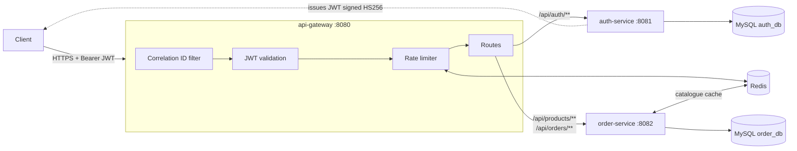

# Scalable Microservices Gateway & Core API Suite


Three Spring Boot services that make up a small but production-shaped backend:

- **api-gateway**: the single entry point. It handles routing, checks JWTs at the edge, applies Redis-backed rate limiting, and adds a correlation ID to every request.
- **auth-service**: handles registration and login, and issues signed JWTs with role-based access control (USER / ADMIN).
- **order-service**: provides a product catalogue (cached in Redis) and orders, with ownership rules, a status lifecycle, idempotent order creation and indexed queries.

Every service is **stateless**, owns its **own database**, and checks tokens itself. Calls that bypass the gateway are therefore still protected.

> This is a personal portfolio project. It rebuilds, in open-source form, the kind of secure REST services I worked on at Infosys. It contains no client or employer code or data.

## Architecture



**Request flow:**

1. A client logs in through `/api/auth/login` and receives a 30-minute JWT. The `sub` claim is the username and the `roles` claim holds `["USER"]` or `["ADMIN"]`.
2. Each later call goes through the gateway, which rejects missing, forged or expired tokens with `401` before any service is called.
3. The service validates the token again and applies role and ownership rules. For example, a customer only sees their own orders, and only an ADMIN can change an order's status.

## Features

| Area | Implementation |
|---|---|
| Edge security | Spring Cloud Gateway + Spring Security reactive resource server (signature, expiry and issuer checks) |
| Auth | BCrypt password hashing, stateless JWTs (Nimbus, HS256), `@PreAuthorize` role checks |
| RBAC | `roles` claim → `ROLE_*` authorities. Admin-only catalogue changes, status changes and user management |
| Data ownership | Customers can only read and cancel their own orders. Other users' orders return `404`, so order numbers can't be probed |
| Rate limiting | Redis token bucket per user (or per IP when anonymous), shared by all gateway instances |
| Caching | Product catalogue cached in Redis with a TTL and evicted on every change |
| Performance | Composite indexes for the hot queries, `@EntityGraph` to avoid N+1 queries, and list endpoints that never load order items |
| Consistency | Idempotent `POST /orders` via `Idempotency-Key`, optimistic locking (`@Version`), and a guarded order status state machine |
| Traceability | `X-Correlation-Id` created or propagated at the gateway and returned to the client |
| Ops | Flyway migrations, Actuator health, RFC 7807 problem responses, one Dockerfile for all services, GitHub Actions CI |

## Tech stack

Java 17 · Spring Boot 3.3 · Spring Cloud Gateway · Spring Security (OAuth2 resource server / JWT) · Spring Data JPA · Hibernate · MySQL 8 · Flyway · Redis · JUnit 5 · Mockito · Spring Security Test · H2 (tests) · Docker Compose · GitHub Actions · JaCoCo

## Run it locally

```bash
docker compose up --build
```

This starts MySQL, Redis and all three services. The gateway is at `http://localhost:8080`. An admin account (`admin` / `Admin12345`) is created on first start; change it with `ADMIN_USERNAME` / `ADMIN_PASSWORD` (see `.env.example`).

```bash
# 1. register and log in
curl -X POST localhost:8080/api/auth/register -H 'Content-Type: application/json' \
  -d '{"username":"raj","email":"raj@example.com","password":"Password1"}'

TOKEN=$(curl -s -X POST localhost:8080/api/auth/login -H 'Content-Type: application/json' \
  -d '{"username":"raj","password":"Password1"}' | sed 's/.*"accessToken":"\([^"]*\)".*/\1/')

# 2. browse the catalogue (public)
curl localhost:8080/api/products

# 3. place an order (safe to retry with the same Idempotency-Key)
curl -X POST localhost:8080/api/orders -H "Authorization: Bearer $TOKEN" \
  -H 'Idempotency-Key: checkout-001' -H 'Content-Type: application/json' \
  -d '{"items":[{"sku":"KB-MECH-01","quantity":1},{"sku":"MS-WL-02","quantity":2}]}'

# 4. list my orders
curl localhost:8080/api/orders -H "Authorization: Bearer $TOKEN"
```

## API (through the gateway)

**auth-service**

| Method | Path | Access |
|---|---|---|
| `POST` | `/api/auth/register` | public. New accounts are always `USER` |
| `POST` | `/api/auth/login` | public. Returns `accessToken`, `tokenType`, `expiresIn` |
| `GET` | `/api/auth/me` | signed in |
| `GET` | `/api/auth/users` | ADMIN |
| `PATCH` | `/api/auth/users/{id}/role` | ADMIN |

**order-service**

| Method | Path | Access |
|---|---|---|
| `GET` | `/api/products`, `/api/products/{sku}` | public (cached) |
| `POST` / `PUT` | `/api/products`, `/api/products/{sku}` | ADMIN (evicts cache) |
| `POST` | `/api/orders` | signed in. Optional `Idempotency-Key` header |
| `GET` | `/api/orders?page=&size=` | signed in. Your own orders, newest first |
| `GET` | `/api/orders/{orderNumber}` | owner or ADMIN |
| `POST` | `/api/orders/{orderNumber}/cancel` | owner, before shipping |
| `PATCH` | `/api/orders/{orderNumber}/status` | ADMIN. `CREATED → CONFIRMED → SHIPPED → DELIVERED`, or `CANCELLED` before shipping |
| `GET` | `/api/orders/admin/search?status=` | ADMIN |

Errors are returned as `application/problem+json`: `400` validation, `401` no or invalid token, `403` wrong role, `404` not found, `409` concurrent update, `422` business rule (for example, an inactive product or an invalid status change).

## Tests

```bash
mvn verify
```

| Module | What is covered |
|---|---|
| api-gateway | Missing, forged and expired tokens are rejected at the edge. Valid tokens are routed. Public routes and health checks are open. The caller's correlation ID is kept |
| auth-service | Token contents, forged-key and wrong-issuer rejection, and the weak-secret guard. Full register → login → `/me` flow, duplicate and validation errors, and admin-only endpoints |
| order-service | Server-side pricing, line merging, inactive products, idempotent replay, ownership checks and the status state machine. Full API tests with JWTs for USER and ADMIN |

CI runs the tests for all modules, uploads the JaCoCo reports, and builds a Docker image for each service.

## Project layout

```
api-gateway/     Spring Cloud Gateway: routes, JWT check, rate limiting, correlation IDs
auth-service/    users, BCrypt, JWT issuing, RBAC
order-service/   products + orders, Redis cache, Flyway schema with indexes
docker/          MySQL init (one database per service)
Dockerfile       shared multi-stage build: --build-arg MODULE=<service>
```

## Production notes

- Set a long random `JWT_SECRET` (32+ characters). The default exists only for local runs. For many teams or external clients, switch to RS256 with a JWK endpoint so services only hold the public key.
- Put TLS in front of the gateway, and keep the services on a private network.

## Author

**Raj Kumar Bonda**, Java Backend Engineer · [LinkedIn](https://www.linkedin.com/in/rajkumar-bonda-b6a579279/) · [GitHub](https://github.com/Rajkumar2119)
